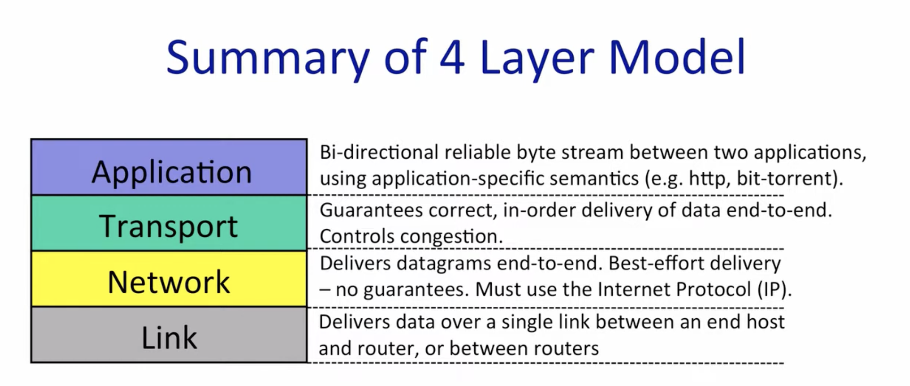

# 四层网络模型 (4-Layer Network Model)

## 概述

网络通信采用分层架构，每一层都有特定的职责和功能。四层模型是TCP/IP协议栈的核心架构，由下至上分别是：链路层、网络层、传输层和应用层。

## 各层详解

### 1. 应用层 (Application Layer)

**主要功能：**
- 提供应用程序之间的双向可靠字节流通信
- 使用应用特定的语义和协议

**特点：**
- 面向用户应用程序
- 定义应用之间如何交换数据
- 每种应用有自己的协议规范

**常见协议：**
- HTTP/HTTPS：Web浏览
- FTP：文件传输
- SMTP：电子邮件
- DNS：域名解析
- BitTorrent：P2P文件共享

**关键概念：**
- 提供端到端的应用级通信
- 定义数据格式和消息语义

---

### 2. 传输层 (Transport Layer)

**主要功能：**
- 保证数据的正确性和有序性
- 端到端的可靠传输
- 拥塞控制

**特点：**
- 在不可靠的网络层之上提供可靠服务
- 负责进程到进程的通信
- 流量控制和错误恢复

**主要协议：**

**TCP (Transmission Control Protocol):**
- 面向连接
- 可靠传输（确认、重传机制）
- 有序传输
- 拥塞控制
- 流量控制

**UDP (User Datagram Protocol):**
- 无连接
- 不可靠传输
- 无序传输
- 开销小，速度快
- 适用于实时应用（视频、音频流）

**关键概念：**
- 端口号：标识主机上的应用进程
- 可靠性保证：通过序列号、确认应答、超时重传
- 拥塞控制：避免网络过载

---

### 3. 网络层 (Network Layer)

**主要功能：**
- 端到端的数据报传输
- 路由选择和转发
- 地址管理

**特点：**
- 尽力而为（Best-effort）服务，不保证可靠性
- 必须使用IP协议（Internet Protocol）
- 负责跨网络传输

**核心协议：**
- **IP (Internet Protocol):** 定义数据包格式和寻址
  - IPv4：32位地址
  - IPv6：128位地址
- **ICMP:** 错误报告和诊断（如ping）
- **ARP:** 地址解析协议（IP地址到MAC地址）

**关键功能：**
- **路由选择：** 确定数据包从源到目的地的路径
- **分组转发：** 根据路由表转发数据包
- **地址管理：** IP地址的分配和管理
- **分片与重组：** 处理不同MTU（最大传输单元）的网络

**关键概念：**
- IP地址：唯一标识网络中的设备
- 路由器：连接不同网络，转发数据包
- 无连接服务：每个数据包独立处理
- 不保证顺序、可靠性或时延

---

### 4. 链路层 (Link Layer)

**主要功能：**
- 在单个链路上传输数据
- 相邻节点之间的通信

**特点：**
- 处理物理链路层面的数据传输
- 在主机和路由器之间，或路由器和路由器之间传输帧
- 与硬件密切相关

**主要功能：**
- **成帧（Framing）：** 将网络层数据封装成帧
- **物理地址：** 使用MAC地址标识设备
- **错误检测：** CRC校验等机制
- **流量控制：** 协调发送和接收速率
- **介质访问控制：** 管理共享介质的访问

**常见技术：**
- Ethernet（以太网）
- WiFi（802.11）
- PPP（点对点协议）
- ARP（地址解析协议）

**关键概念：**
- MAC地址：硬件物理地址
- 帧：链路层的数据单元
- 单跳传输：只负责相邻节点间的传输

---

## 数据封装过程

从应用层到链路层，数据经过层层封装：

1. **应用层：** 应用数据 → Message
2. **传输层：** Message + TCP/UDP头 → Segment（TCP）/ Datagram（UDP）
3. **网络层：** Segment/Datagram + IP头 → Packet
4. **链路层：** Packet + 帧头/帧尾 → Frame

每一层都会添加自己的控制信息（头部），形成协议数据单元（PDU）。

---

## 层次间的关系

- **应用层** 依赖传输层提供的可靠或不可靠服务
- **传输层** 依赖网络层的端到端数据报传输
- **网络层** 依赖链路层在各个链路上传输数据
- **链路层** 负责实际的物理传输

每一层只与相邻层交互，通过明确的接口提供服务，实现了模块化和解耦。

---

## 关键区别总结

| 层次 | 传输单元 | 地址类型 | 主要协议 | 可靠性 | 作用范围 |
|------|---------|---------|---------|-------|---------|
| 应用层 | Message | - | HTTP, FTP, DNS | 依赖传输层 | 端到端（进程） |
| 传输层 | Segment/Datagram | 端口号 | TCP, UDP | TCP可靠，UDP不可靠 | 端到端（主机） |
| 网络层 | Packet | IP地址 | IP, ICMP | 不可靠 | 端到端（跨网络） |
| 链路层 | Frame | MAC地址 | Ethernet, WiFi | 有限的错误检测 | 单跳（相邻节点） |

## Reasons for Layering
1. Modularity
2. Well defined service
3. Reuse
4. Separation of concerns
5. Continuous improvement
6. Peer-to-peer communications

## Encapsulation:
- HTTP application payload in
- a TCP transport segment in
- an IP network packet in
- a WiFi link frame
- 