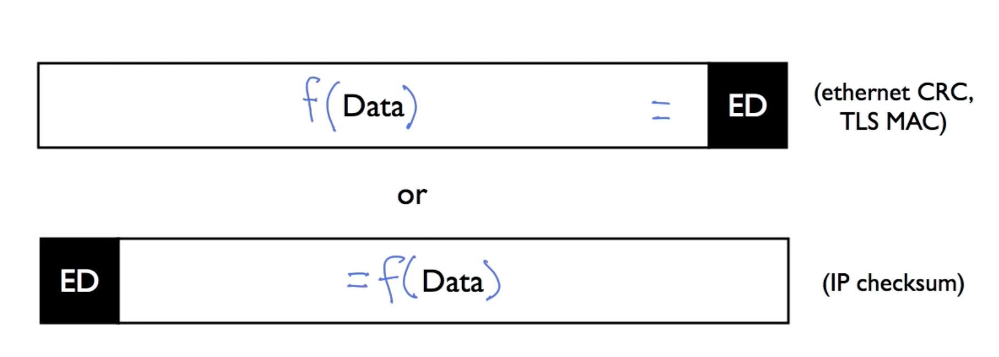

# Error Detection

## Checksum

Sums all data words using ones'-complement arithmetic and appends the result; the receiver re-computes and checks for consistency.

**Pros:** Simple to implement; low computational overhead.  
**Cons:** Weak protection — certain multi-bit error patterns cancel out and go undetected.

---

## CRC (Cyclic Redundancy Check)

Treats the data as a polynomial, divides by a generator polynomial, and appends the remainder (FCS) to the frame.

**Pros:** Detects all **single-bit errors** and most burst errors; widely standardized (CRC-32).  
**Cons:** Higher computational cost than checksum; cannot correct errors, only detect them.

---

## MAC (Message Authentication Code)

Applies a secret key and a hash function to a message to produce a cryptographic tag that travels with the data.

**Pros:** Detects both accidental corruption and **deliberate tampering**; provides sender authentication.  
**Cons:** Requires shared secret key management; higher overhead than CRC or checksum.