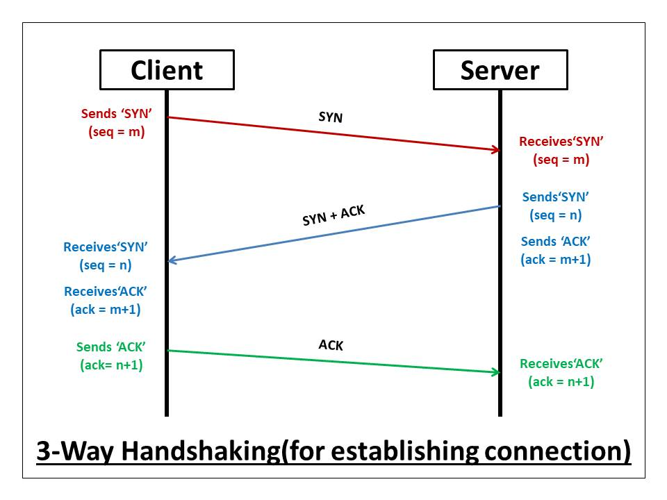
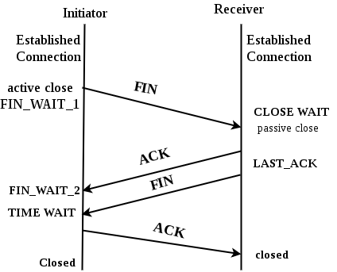
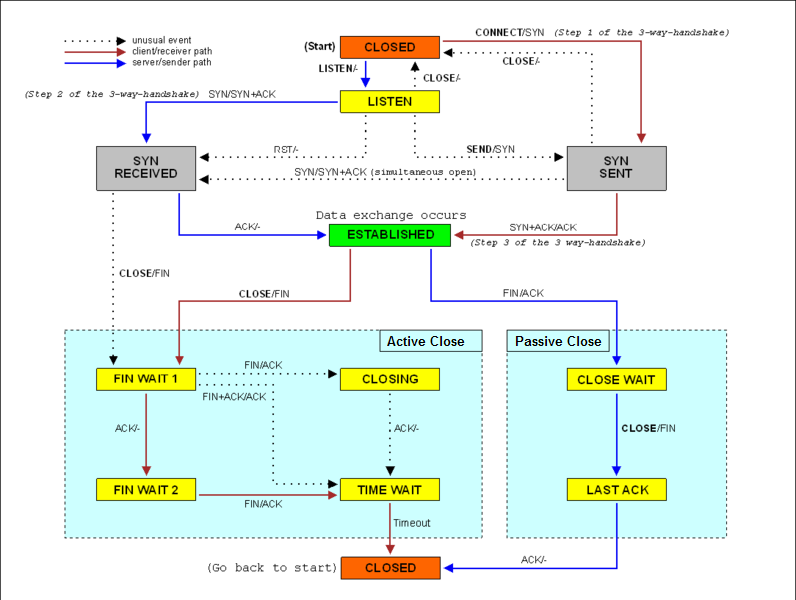

# TCP Byte Stream

TCP provides a **reliable, ordered, connection-oriented** byte stream over the unreliable IP layer.

---

## 3-Way Handshake



Synchronizes both sides before data flows.

1. **SYN** — Client sends SYN with its Initial Sequence Number (`seq = x`).
2. **SYN-ACK** — Server replies with its own ISN and acknowledges client (`seq = y`, `ack = x+1`).
3. **ACK** — Client acknowledges server (`ack = y+1`). Connection is **ESTABLISHED**.

> Each SYN consumes one sequence number, hence `ack = ISN + 1`.

---

## Connection Teardown



Each direction closes independently via a **4-way FIN exchange**.

1. **FIN** — Active closer signals end of its data.
2. **ACK + Data** — Passive closer acknowledges; connection is now **half-closed**.
3. **FIN** — Passive closer finishes sending and sends its own FIN.
4. **ACK** — Active closer acknowledges, then enters **TIME_WAIT (2 × MSL)** before releasing the port.

---

## Acknowledgement

TCP uses **cumulative ACKs**: `ACK = N` means "received all bytes up to N−1; send N next."

- **Delayed ACK**: receiver waits up to 200 ms to piggyback ACK on outgoing data.
- **Out-of-order**: receiver buffers the segment and sends a **duplicate ACK** (same ACK number).
- **Fast Retransmit**: 3 duplicate ACKs trigger immediate retransmission without waiting for timeout.

---

## Sequence Number

A 32-bit number identifying the **first byte of payload** in each segment.

- The ISN is chosen **randomly** to avoid stale segment collisions from old connections.
- Numbers **wrap around** modulo 2³²; MSL bounds ensure no live segment survives a full wrap.
- Enables the receiver to **reorder** segments and **discard duplicates**.

---

## Checksum

A mandatory **16-bit one's complement checksum** over:

- A **pseudo-header** (src IP, dst IP, protocol, TCP length) — catches misdelivered packets.
- The **TCP header** and **payload**.

A failing checksum causes the segment to be **silently dropped**; the missing ACK triggers retransmission. The checksum is weak by modern standards — application-layer integrity (e.g. TLS) is still needed.

---

## Flow Control

Prevents a fast sender from overwhelming the **receiver's buffer** using the advertised receive window `rwnd`.

- Receiver sets `rwnd = free buffer space` in every ACK.
- Sender enforces: `UnackedBytes ≤ rwnd`.
- If `rwnd = 0`, sender sends periodic **1-byte probes** to detect window reopening (avoids deadlock).
- **Nagle's algorithm** (sender) and **Clark's solution** (receiver) mitigate Silly Window Syndrome.

> Flow control is end-to-end only; **congestion control** handles network-level capacity separately.

---

## The TCP Segment Format

```
 0                   1                   2                   3
 0 1 2 3 4 5 6 7 8 9 0 1 2 3 4 5 6 7 8 9 0 1 2 3 4 5 6 7 8 9 0 1
+-+-+-+-+-+-+-+-+-+-+-+-+-+-+-+-+-+-+-+-+-+-+-+-+-+-+-+-+-+-+-+-+
|          Source Port          |       Destination Port        |
+-+-+-+-+-+-+-+-+-+-+-+-+-+-+-+-+-+-+-+-+-+-+-+-+-+-+-+-+-+-+-+-+
|                        Sequence Number                        |
+-+-+-+-+-+-+-+-+-+-+-+-+-+-+-+-+-+-+-+-+-+-+-+-+-+-+-+-+-+-+-+-+
|                    Acknowledgment Number                      |
+-+-+-+-+-+-+-+-+-+-+-+-+-+-+-+-+-+-+-+-+-+-+-+-+-+-+-+-+-+-+-+-+
|Data Offset| Reserved  |U|A|P|R|S|F|          Window           |
+-+-+-+-+-+-+-+-+-+-+-+-+-+-+-+-+-+-+-+-+-+-+-+-+-+-+-+-+-+-+-+-+
|           Checksum            |         Urgent Pointer        |
+-+-+-+-+-+-+-+-+-+-+-+-+-+-+-+-+-+-+-+-+-+-+-+-+-+-+-+-+-+-+-+-+
|                    Options (variable)                         |
+-+-+-+-+-+-+-+-+-+-+-+-+-+-+-+-+-+-+-+-+-+-+-+-+-+-+-+-+-+-+-+-+
|                             Data                              |
+-+-+-+-+-+-+-+-+-+-+-+-+-+-+-+-+-+-+-+-+-+-+-+-+-+-+-+-+-+-+-+-+
```

| Field | Size | Purpose |
|---|---|---|
| Source / Dest Port | 16 bits each | Identify application endpoints |
| Sequence Number | 32 bits | Byte offset of first payload byte |
| Acknowledgment Number | 32 bits | Next expected byte (valid when ACK flag set) |
| Data Offset | 4 bits | Header length in 32-bit words (min 5 = 20 bytes) |
| Flags | 6 bits | URG, ACK, PSH, RST, SYN, FIN |
| Window | 16 bits | Advertised `rwnd` for flow control |
| Checksum | 16 bits | Integrity check over pseudo-header + header + data |
| Urgent Pointer | 16 bits | Offset to urgent data (URG flag only; rarely used) |
| Options | Variable | MSS, WSCALE, timestamps, SACK, etc. |

\
**A Finite State Machine Example of TCP:**
