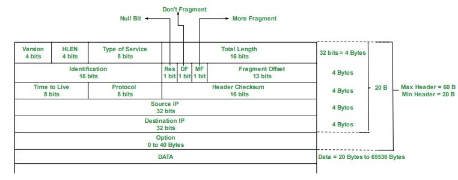

# Internet Protocol (IP)

## Overview

**IP (Internet Protocol)** is the core Network Layer (Layer 3) protocol that routes packets across networks.

**Key Characteristics:**
- **Connectionless**: Each packet handled independently
- **Unreliable**: No delivery guarantee
- **Best-effort**: Tries to deliver but doesn't promise

**What IP Does NOT Do:**
- No flow control, error recovery, retransmission, or delivery confirmation, only notice of failure
- These are handled by Transport Layer (TCP)

---

## Why is IP Simple?

**Design Philosophy: End-to-End Principle**
- Keep network core simple and fast
- Put complexity at endpoints (applications)
- "Stupid network, smart edges"

**Benefits:**
- **Scalability**: Simple = faster routing, supports billions of devices
- **Flexibility**: Works over any link layer, supports any transport protocol
- **Efficiency**: Routers process packets at line speed

**Trade-off:**
- Network layer: simple, fast, unreliable (IP)
- Transport layer: complex, slower, reliable (TCP)

---

## The Four Key Mechanisms

### 1. Prevent Packets Looping Forever

**Problem:** Misconfigured routes → infinite loops

**Solution: TTL (Time to Live)**
- Each packet has TTL counter (typically 64 or 128)
- Each router decrements TTL by 1
- TTL = 0 → discard packet, send ICMP "Time Exceeded"

---

### 2. Fragment Packets if Too Long

**Problem:** Different MTUs (Maximum Transmission Unit)
- Ethernet: 1500 bytes
- WiFi: 1500 bytes
- Jumbo frames: 9000 bytes

**Solution: Fragmentation**
- Router splits large packets into smaller fragments
- Uses **Identification** field (same ID for all fragments)
- Uses **Flags**: DF (Don't Fragment), MF (More Fragments)
- Uses **Fragment Offset** (in 8-byte units)

**Reassembly:**
- Only at destination (not at intermediate routers)
- If ANY fragment lost → entire packet discarded
- Modern approach: Path MTU Discovery (avoid fragmentation)

---

### 3. Header Checksum

**Purpose:** Detect header errors, prevent wrong delivery

**Coverage:**
- Only IP header (not data)
- Data checked by TCP/UDP

**Process:**
- Sender calculates checksum using one's complement
- Receiver verifies by recalculating
- Mismatch → discard silently

**Key Point:**
- Every router recalculates checksum (because TTL changes)

---

### 4. Version Field

**Purpose:** Allow protocol evolution

**Version Field (4 bits):**
- IPv4 = 4 (0100)
- IPv6 = 6 (0110)

**Transition Mechanisms:**
- Dual Stack: Run IPv4 and IPv6 simultaneously
- Tunneling: Encapsulate IPv6 in IPv4
- Translation: NAT64

---

## IPv4 Datagram

### Header Structure



### Header Fields

| Field | Size | Description |
|-------|------|-------------|
| **Version** | 4 bits | IPv4 = 4 |
| **IHL** | 4 bits | Header length in 32-bit words (min 5 = 20 bytes, max 15 = 60 bytes) |
| **Type of Service** | 8 bits | QoS (rarely used) |
| **Total Length** | 16 bits | Header + data (max 65,535 bytes) |
| **Identification** | 16 bits | Fragment group ID |
| **Flags** | 3 bits | Bit 0: Reserved, Bit 1: DF, Bit 2: MF |
| **Fragment Offset** | 13 bits | Fragment position (×8 bytes) |
| **TTL** | 8 bits | Hop limit (Linux: 64, Windows: 128) |
| **Protocol** | 8 bits | 1=ICMP, 6=TCP, 17=UDP |
| **Header Checksum** | 16 bits | Header error detection |
| **Source IP** | 32 bits | Sender address |
| **Destination IP** | 32 bits | Receiver address |
| **Options** | Variable | Rarely used (0-40 bytes) |

---

## IP Addressing

### IPv4 Address Format
- 32 bits, dotted decimal: `192.168.1.1`
- Binary: `11000000.10101000.00000001.00000001`

### Special Addresses

| Range | Purpose |
|-------|---------|
| 0.0.0.0/8 | This network / Default route |
| 127.0.0.0/8 | Loopback (localhost) |
| 10.0.0.0/8 | Private (Class A) |
| 172.16.0.0/12 | Private (Class B) |
| 192.168.0.0/16 | Private (Class C) |
| 169.254.0.0/16 | Link-local (APIPA) |
| 224.0.0.0/4 | Multicast |
| 255.255.255.255 | Broadcast |

---

## Routing

### Router Processing Steps

1. **Check TTL** → If 0, discard; else decrement
2. **Verify Checksum** → If bad, discard
3. **Update Checksum** → Recalculate for new TTL
4. **Lookup Route** → Use longest prefix match
5. **Forward** → Send to next hop or deliver locally

### Longest Prefix Match

Choose the most specific (longest) matching route.

**Example:**
```
Routing Table:
192.168.1.0/24  → Router A
192.168.0.0/16  → Router B
0.0.0.0/0       → Router C (default)

For 192.168.1.50:
- Matches /24 (most specific) ✓ → Router A
- Matches /16
- Matches /0
```
## Netmask
- Determines if a destination IP is on the same local network or needs to go through a gateway/router.
  
**Example:**
```
IP:      192.168.1. 50
Mask:    255.255.255. 0
         └─ network ─┘ └─host─┘
```

## CIDER
- A more fine-grained IP address division that is instead of Class A/B/C

**Example:**

| CIDR | 子网掩码 | 可用主机数 |
|------|----------|-----------|
| /8 | 255.0.0.0 | ~16,777,214 |
| /16 | 255.255.0.0 | ~65,534 |
| /24 | 255.255.255.0 | 254 |

<!-- related:start -->
## 相关笔记

- [计算机网络索引](%E8%AE%A1%E7%AE%97%E6%9C%BA%E7%BD%91%E7%BB%9C%E7%B4%A2%E5%BC%95.md)
- [1-The4LayerModel](1-The4LayerModel.md)
- [ICMP](ICMP.md)
<!-- related:end -->
