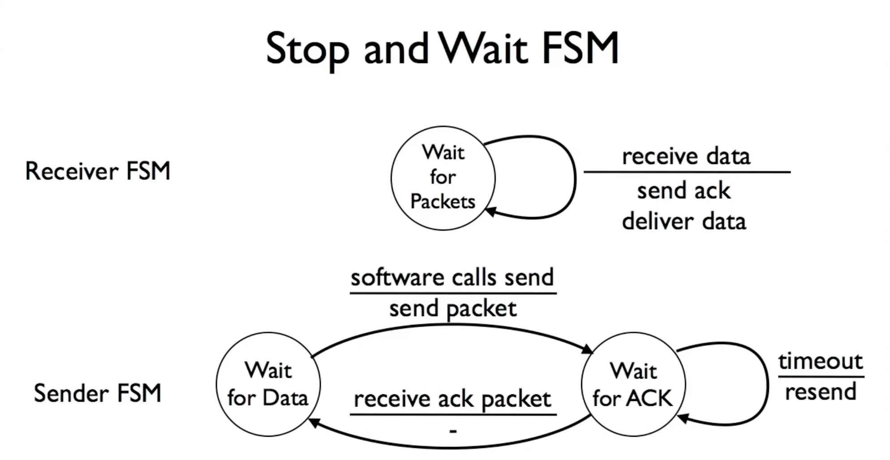

# Flow Control

## Stop and Wait
- At most one packet in flight at any time
- Sender sends one packet
- Receiver sends acknowledgement packet when it receives data
- On reveiving ack, sender sends new data
- On timeout, sender sends back current data

## Sliding Window
### Sliding Window Receiver
- Maintain 3 variables
  - Receive window size (RWS)
  - Last acceptable segment (LAS)
  - Last segment received (LSR)
- Maintain invariant: (LAS - LSR) ≤ RWS
- If received packet is < LAS, send acknowledgment
  - Send *cumulative* acks: if received 1, 2, 3, 5, acknowledge 3
  - NOTE: TCP acks are next *expected* data (e.g., ack 4 in above example)

### RWS, SWS, and Sequence Space
- RWS ≥ 1, SWS ≥ 1, RWS ≤ SWS
- If RWS = 1, "go back N" protocol, need SWS+1 sequence numbers
- If RWS = SWS, need 2SWS sequence numbers
- Generally need RWS+SWS sequence numbers
  - RWS packets in unknown state (ACK may/may not be lost)
  - SWS packets in flight must not overflow sequence number space

### Retransmission Strategies
1. Go back N
   -  Rolls back to the first unacknowledged frame and retransmits it plus all subsequent frames that had already been sent.
2. Selective Repeat
   - Only retransmit the packet that is lost.

<!-- related:start -->
## 相关笔记

- [计算机网络索引](%E8%AE%A1%E7%AE%97%E6%9C%BA%E7%BD%91%E7%BB%9C%E7%B4%A2%E5%BC%95.md)
- [TCP](TCP.md)
<!-- related:end -->
