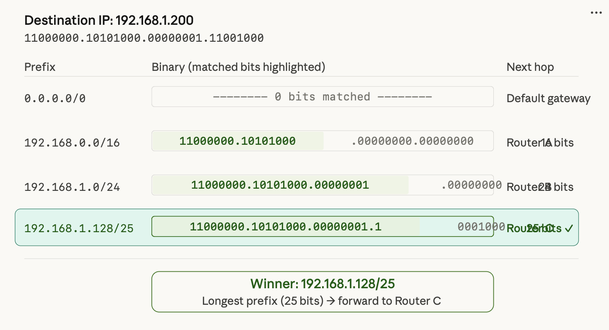

# Link Layer
## Statistical Multiplexing

- Multiple users **share** a link on demand instead of holding fixed bandwidth allocations
- Works because user traffic is **bursty** — peak demands rarely coincide simultaneously
- By the Law of Large Numbers, aggregate traffic is predictable, enabling **overselling** of bandwidth
- Trade-off: introduces **queuing delay and packet loss** (**no deterministic delay guarantee**)
- The Internet's **packet switching** is its direct implementation; contrasts with circuit switching

## Longest Prefix Match Algorithm for internet routers
Often multiple routing table entries match the destination IP address. LPM resolves the tie with a simple rule: use the most specific match, i.e., the entry whose prefix shares the longest common bit string with the destination.

**Example:**

## Address Resolution Protocol
Maps an IP address to a MAC address within a local network.

<!-- related:start -->
## 相关笔记

- [计算机网络索引](%E8%AE%A1%E7%AE%97%E6%9C%BA%E7%BD%91%E7%BB%9C%E7%B4%A2%E5%BC%95.md)
- [1-The4LayerModel](1-The4LayerModel.md)
- [Error_detection](Error_detection.md)
- [packetswitch](packetswitch.md)
<!-- related:end -->
