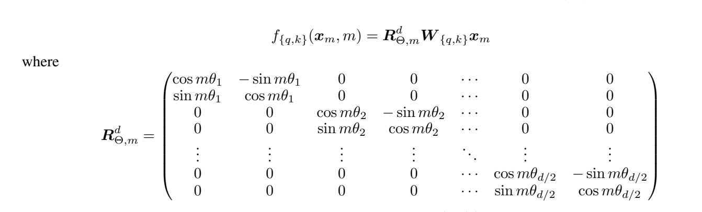
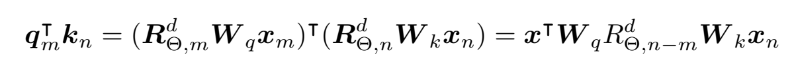
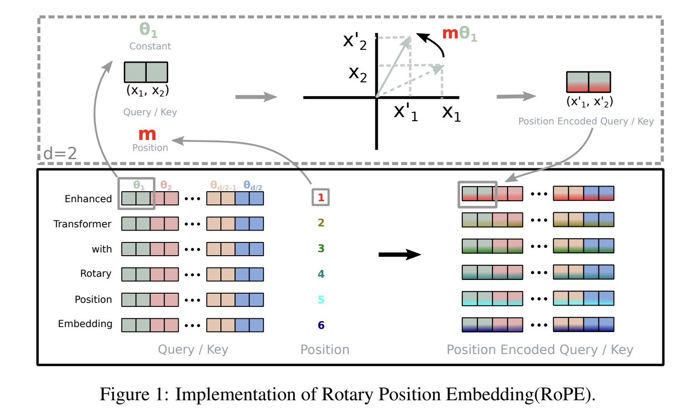

# 位置编码
1. Sinisoidal Encoding
2. RoPE
```Text
通过绝对位置编码的方式实现相对位置编码；
利用旋转矩阵对于不同token之间的相对位置进行编码
```




Rope图示



## 为什么使用sin和cos位置编码？

相对位置的线性表达： 利用三角函数的和差化积公式，位置 pos+k 的编码可以表示为位置 pos 编码的线性变换（旋转）。这让 Self-Attention 能够很容易地学习到词与词之间的相对距离关系。

数值稳定性： Sin/Cos 的值域在 [−1,1]，相比于直接使用整数位置，它不会因为序列变长而数值爆炸，且不需要额外的归一化处理。

泛化能力： 它是确定性的函数，不需要像 Learned Embedding 那样受限于训练时的最大长度，理论上可以处理任意长度的序列。”

<!-- related:start -->
## 相关笔记

- [Transformer与模型架构索引](Transformer%E4%B8%8E%E6%A8%A1%E5%9E%8B%E6%9E%B6%E6%9E%84%E7%B4%A2%E5%BC%95.md)
- [ucloud](../../interview-prep/logs/2024/ucloud.md)
- [所有面试合并总结](../../interview-prep/%E6%89%80%E6%9C%89%E9%9D%A2%E8%AF%95%E5%90%88%E5%B9%B6%E6%80%BB%E7%BB%93.md)
- [Transformer模型结构](Transformer%E6%A8%A1%E5%9E%8B%E7%BB%93%E6%9E%84.md)
- [不同大模型架构](%E4%B8%8D%E5%90%8C%E5%A4%A7%E6%A8%A1%E5%9E%8B%E6%9E%B6%E6%9E%84.md)
<!-- related:end -->
