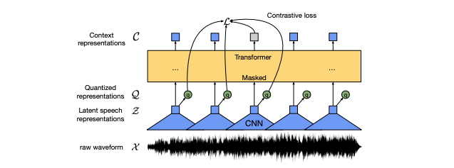
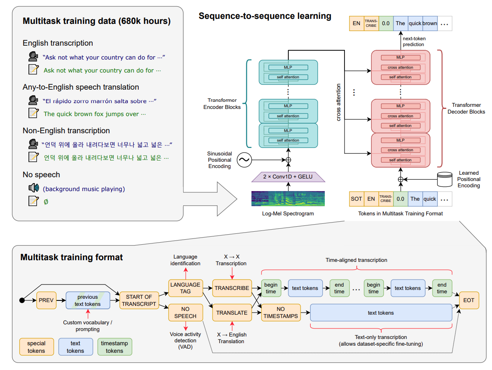

# 语音模型
# wav2vec2.0
wav2vec 2.0 是一个**自监督语音表征学习框架**：先把原始语音通过 CNN 编码成连续潜表示，在**潜空间做 span masking**，再用 Transformer 建上下文表示；训练时用**对比学习**去识别被 mask 位置对应的“真目标”，而目标来自一个**联合学习的离散量化器**。最后用少量标注数据用 **CTC** 微调即可做 ASR。

---

## 1) 总体结构（3 个模块）
1. **Feature Encoder（CNN）**：`raw waveform X -> latent z1...zT`
2. **Context Network（Transformer）**：`z -> contextual c1...cT`（建全局上下文）
3. **Quantization Module（product quantization + Gumbel-Softmax）**：`z -> quantized qt`（离散单位，用作对比学习目标）

> 核心直觉：Transformer 吃的是“连续 z（更信息密）”，但对比学习的目标用“离散 qt（更稳定/更可分）”。

---

## 2) Masking：在潜空间做 span mask（不是在波形/梅尔谱上）
- 先在时间步里抽样一部分起点（比例 `p=0.065`），对每个起点 mask 掉后续 `M=10` 个时间步（span 可重叠）
- 实际被 mask 的比例约 **49%**（平均 span 长度约 299ms）
- 被 mask 的 z 会被替换成一个**可学习的共享 mask 向量**
- **注意：量化器输入不 mask**（只 mask 给 Transformer 的输入）

---

## 3) 自监督目标：对比学习 + 码本多样性
### 3.1 对比损失（Contrastive Loss）
对每个被 mask 的时间步 `t`，用上下文表示 `ct` 去从候选集合里挑出真目标 `qt`：
- 候选集合大小：`K+1`（真目标 + K 个负样本）
- 负样本来源：同一个 utterance 里**其它被 mask 的时间步**的量化表示（均匀采样）
- 相似度：cosine sim
- 温度：`κ = 0.1`
- 论文里常用 `K = 100`

### 3.2 多样性损失（Diversity Loss）
- 防止量化码本“只用少数 token”
- 做法：鼓励每个 codebook 的平均选择分布的熵更大（更均匀）
- 总损失：`L = Lm + α Ld`，论文里 `α=0.1`

---

## 4) 量化器：Product Quantization + Gumbel-Softmax（端到端学离散单位）
- `G` 个 codebook（groups），每个 codebook 有 `V` 个条目
- 每个 group 选一个条目，拼接起来得到离散向量，再线性映射
- 用 **Gumbel-Softmax + straight-through estimator** 做可微的“离散选择”
- 论文设置：
  - `G = 2`
  - `V = 320`
  - 理论最大 codewords：`V^G = 102.4k`
  - Gumbel 温度从 2 逐步 anneal 到更小（BASE 到 0.5，LARGE 到 0.1）
  - 离散发生在模型内部，所以要使用Gumbel Softmax

---

## 5) 具体网络配置（可背参数）
### 5.1 CNN Feature Encoder
- 7 个卷积块，每块：Temporal Conv + LayerNorm + GELU
- 每块 512 channels
- strides: `(5,2,2,2,2,2,2)`
- kernel widths: `(10,3,3,3,3,2,2)`
- 输出步频约 **49Hz**（每步约 20ms）
- 感受野约 **25ms**

### 5.2 Transformer Context Network
- 用一个 **卷积层做相对位置编码**（kernel size 128，groups 16），加到输入上再 LN
- 两个规模：
  - **BASE**：12 层，d_model=768，FFN=3072，8 heads（约 95M 参数）
  - **LARGE**：24 层，d_model=1024，FFN=4096，16 heads（约 317M 参数）

---

## 6) 微调（Fine-tuning）：CTC + 冻结 CNN
- 在 Transformer 顶部加线性分类层，做字符级/音素级预测
- 损失：**CTC**
- 微调时：
  - 前 10k steps 只训练输出分类头
  - 之后更新 Transformer
  - **CNN feature encoder 不更新（冻结）**
- 微调阶段用“类似 SpecAugment 的 mask”（时间步与通道维）

---

## 8) Ablation（你可以用来回答“为什么这么设计”）
- 论文强调：**只把量化用于对比目标**，不要把量化后的表示喂给 Transformer
- 一个关键对比（dev WER，三次种子平均）：
  - **连续输入 + 量化目标（最好）**
  - 量化输入（无论目标量化与否）都会明显变差
  - 连续输入 + 连续目标也会变差（说明“离散目标”是关键增益点）

---

## 9) 创新点总结（面试高频）
1. **Masking 在 latent space**：更像 BERT 的 masked modeling，但对象是 CNN 提取的语音潜表示。
2. **对比学习目标来自“联合学习的离散量化器”**：把“学离散语音单位”和“学上下文表征”合成一个端到端系统。
3. **对比损失 + 码本多样性约束**：既保证可分性，也避免码本塌缩。
4. **预训+CTC 微调的极强数据效率**：10 分钟/1 小时标注也能做到很低 WER。
5. **工程上简单**：相比多轮伪标签/反复自训练的方法，流程更直接（一次预训 + 一次微调）。

---

## 10) 一段你可以直接说的“流程描述”
“wav2vec 2.0 先用 CNN 把波形变成 20ms 步长的 latent 序列，在 latent 上随机 mask 掉接近一半的时间步，把连续 latent 输入 Transformer 得到上下文表示；训练时用对比学习，让每个被 mask 的位置从同一句话里的负样本里识别出正确的量化目标，同时加码本多样性损失避免 collapse。预训完后用少量标注数据做 CTC 微调就能做 ASR。”

# Whisper
Whisper 是 OpenAI 开源的**通用语音基础模型**：用一个 **encoder–decoder Transformer**，在超大规模弱监督数据上做**多任务联合训练**，实现**多语种转写（ASR）**、**语种识别**、**语音翻译（X→English）**、**时间戳对齐**等能力，并且强调 **zero-shot 鲁棒性**（口音、噪声、领域词汇）。

---

## 1) 核心架构（Encoder–Decoder Transformer）
### 1.1 输入表示（Audio → 特征）
- 统一重采样到 **16 kHz**
- 提取 **80 维 log-Mel 频谱**（25ms 窗，10ms 步长）
- 全局归一化到大致 **[-1, 1]** 的范围（零均值附近）

### 1.2 编码器（Encoder）
- 先过一个很轻的卷积“stem”：**2 层 1D Conv**（第二层 stride=2）+ GELU
- 然后是标准 Transformer encoder blocks（加正弦位置编码）

### 1.3 解码器（Decoder）
- 标准 Transformer decoder（自注意力 + 交叉注意力）
- 预测的是一串 **token 序列**：既包含普通文本 token，也包含“任务/控制 token”（见下一节）

---

## 2) 多任务统一：用“特殊 token”把语音任务写成文本生成
Whisper 的一个关键设计是：把不同语音任务统一成“预测 token 序列”：
- **任务指定 token**：比如 `TRANSCRIBE`（同语种转写）、`TRANSLATE`（翻译到英文）
- **语言标签 token**：让模型先做语种识别/或被显式指定语种
- **时间戳 token**：用于对齐（开始/结束时间），支持“带时间戳的转写”
- **NO_SPEECH**：支持把“无语音片段”当作训练信号（对应 VAD/语音活动检测）
- **提示/先验文本**：可把“上一段文本”作为上下文，提升连贯性（更适合长音频）

> 面试讲法：它用“token 化的任务接口”把传统 ASR pipeline（VAD→ASR→对齐→翻译）压成一个模型一次生成。

---

## 3) 训练数据与训练范式：弱监督规模化
### 3.1 Whisper（原始论文版）
- 训练规模是 **68 万小时**的网络音频转写数据（弱监督，噪声更大但覆盖更广）
- 既做 **多语种 ASR**，也做 **X→English 翻译**，并且包含“无语音片段”用于 VAD 学习

### 3.2 large-v3（常被问的后续版本）
- `large-v3` 进一步扩展：**约 100 万小时弱标注 + 400 万小时伪标注**（用 `large-v2` 生成伪标签）
- 直观理解：用更强的老师模型做自训练，扩大数据覆盖和鲁棒性

---

## 4) 长音频（Long-form）怎么做：30 秒感受野 + 滑窗策略
- Whisper **训练/推理的基本输入窗口是 30 秒**
- 转写更长音频时，一般用两类策略：
  1) **Sequential / Sliding Window（顺序滑窗）**：按 30 秒一段连续解码，并利用模型预测的时间戳来移动窗口（更准，适合批处理长音频）
  2) **Chunked（分段并行）**：把音频切块并行转写，再拼接（更快，适合追求速度）

工程上通常会配合：
- **beam search**
- **temperature fallback / scheduling**
- 对重复、低置信度输出的“回退解码”策略  
来提升长音频稳定性。

---

## 5) Whisper 的“创新点”总结（面试高频）
1. **弱监督的极大规模训练**：不靠精标数据堆砌，而是用网络级别覆盖带来鲁棒性与泛化。  
2. **多任务 token 化统一接口**：转写/翻译/语种识别/VAD/时间戳对齐，用同一个 decoder 生成式框架搞定。  
3. **zero-shot 强泛化**：许多场景不需要针对数据集再微调，直接迁移。  
4. **时间戳 token 机制**：让“对齐”成为模型原生能力，而不是后处理模块。  
5. **版本演进的自训练思路（large-v3）**：用大模型生成伪标签扩大数据，进一步增强覆盖与鲁棒性。

---

## 6) 局限与风险（说出来反而加分）
- **幻觉（hallucination）**：弱监督 + 生成式 decoder 可能在音频不清晰或无语音时“补词”，生成没说过的内容。
- **语言与口音不均衡**：训练数据覆盖少的语种/方言，误差更高。
- **重复输出**：seq2seq 解码在部分长音频场景会出现重复段落，需要用解码策略缓解。
- **高风险领域慎用**：医疗/法律等场景需要强审校与回听机制，不能只信转写文本。

---

## 7) 面试可直接背的 5 句话
1. Whisper 是 **encoder–decoder Transformer**，输入是 16kHz 的 **80 维 log-Mel**，用生成式 decoder 输出转写/翻译等结果。  
2. 它的关键不是“新结构”，而是 **弱监督数据规模化（68 万小时）**带来的鲁棒性与 zero-shot 泛化。  
3. 通过 **特殊 token** 把 ASR、翻译、语种识别、VAD、时间戳对齐统一成一个序列生成任务。  
4. 模型感受野是 **30 秒**，长音频通过 **滑窗 + 时间戳驱动的窗口移动**，配合 beam/temperature 回退策略保证稳定。  
5. 风险点是 **幻觉与不均衡语言表现**，所以高风险业务必须做回听抽检和置信度/异常检测。

# HIFI-GAN
## 1. 论文要解决什么问题
传统两阶段 TTS/VC pipeline 通常是：
1) Text → mel-spectrogram（声学模型）
2) mel-spectrogram → waveform（vocoder）

第 2 步是瓶颈：
- AR vocoder（WaveNet）质量高但很慢（逐点生成）
- Flow（WaveGlow）并行但模型深、参数多
- GAN vocoder（如 MelGAN）快、轻，但以前质量往往追不上 AR/Flow

**HiFi-GAN 的目标：同时做到**
- 接近人声的音质（MOS 高）
- 生成速度极快（GPU/CPU 都快）
- 还能做 unseen speaker 的 mel 反演、端到端 TTS 的配套 fine-tune

---

## 2. 核心创新点（面试最常问）
### 2.1 Multi-Period Discriminator (MPD)：专门抓“周期性”
论文强调：语音里有大量近似正弦的周期信号（不同基频/谐波周期），**判别器如果不会抓周期性，就很难把音质推到“真”**。

**MPD 做法：**
- 用多个子判别器，每个子判别器用一个 period `p`
- 只看“每隔 p 个采样点”的结构：把 1D 音频长度 `T` reshape 成 2D `(T/p, p)`，再用 **2D conv**
- 在 width 轴（p 方向）kernel size 限制为 1，避免混掉不同相位位置
- period 选用 **[2, 3, 5, 7, 11]（质数）**，尽量少重叠、覆盖更多周期模式
- 用 weight norm + leaky ReLU

**直觉记法：**
> MSD 像“多尺度看连续形状”，MPD 像“用不同周期的尺子量波形的节奏感”。

### 2.2 Multi-Scale Discriminator (MSD)：补充连续与长依赖
MPD 由于“抽周期/离散位置”，可能对连续结构不够。  
所以再加上 MelGAN 风格的 MSD：
- 3 个子判别器分别看：raw、×2 average pool、×4 average pool
- strided + grouped conv，leaky ReLU
- 第一个（raw）用 spectral norm 稳定训练，其它用 weight norm

### 2.3 Multi-Receptive Field Fusion (MRF)：生成器里并行大/小感受野
**生成器是全卷积**：mel 输入 → 多层转置卷积上采样 → 输出 waveform。  
关键是在每次上采样后加一个 **MRF 模块**：
- MRF = 多个 residual block 的输出求和
- 每个 residual block 用不同 kernel size / dilation，形成不同感受野
- 直观上：同一层同时建模短周期细节 + 更长跨度结构

而且论文强调：和很多 GAN 生成器一样，**不额外输入噪声**。

---

## 3. 架构概览（你可以在白板上画）
### 3.1 Generator（mel → waveform）
- 输入：mel-spectrogram
- 多次 transposed conv 上采样到采样点级别
- 每个上采样后：MRF（并行多 receptive field 的 ResBlocks 求和）
- 输出：raw waveform

### 3.2 Discriminators
- **MPD**：多 period 子判别器（2D conv on reshaped waveform）
- **MSD**：3 个尺度（raw / ×2 pool / ×4 pool）

---

## 4. 损失函数（这块面试会追问细节）
采用 **LSGAN**（least squares GAN）：
- 判别器把真样本推到 1，把假样本推到 0
- 生成器希望假样本被判成接近 1

额外加两个关键损失来稳定训练、提高对应性：

### 4.1 Mel-Spectrogram L1 Loss
- `L_mel = || φ(x) - φ(G(s)) ||_1`
- 作用：让生成的 waveform 在 mel 域对齐输入条件，并且早期训练更稳

### 4.2 Feature Matching Loss（判别器中间特征的 L1）
- 用判别器各层中间特征的 L1 差作为学习到的“感知距离”
- 作用：稳定、减少对抗训练抖动，提高音质

### 4.3 最终目标
- `L_G = L_adv(G;D) + λ_fm L_fm(G;D) + λ_mel L_mel(G)`
- 论文设定：`λ_fm = 2`, `λ_mel = 45`
- `L_D = L_adv(D;G)`
- 因为 D 是多个子判别器，最终就是对各子判别器求和

---

## 5. 三个 Generator 版本（速度/质量/大小权衡）
论文固定判别器，主要用三个生成器版本做 trade-off：

### V1 / V2 / V3 超参（关键）
- **V1**：`h_u=512`, `k_u=[16,16,4,4]`, `k_r=[3,7,11]`, `D_r=[[1,1],[3,1],[5,1]]×3`
- **V2**：`h_u=128`，其它与 V1 类似（保持相同 receptive field）
- **V3**：`h_u=256`, `k_u=[16,16,8]`, `k_r=[3,5,7]`, `D_r=[[1],[2]], [[2],[6]], [[3],[12]]`
  - ResBlock 结构也更“薄”，层数更少（更快）

---

## 6. 实验结果（面试背数字不必太死，但要会说趋势）
在 LJSpeech 上的 spectrogram inversion：
- **V1**：MOS **4.36±0.07**，参数 **13.92M**；V100 上约 **167.86× realtime**
- **V2**：MOS **4.23±0.07**，参数 **0.92M**；V100 上约 **764.80× realtime**
- **V3**：MOS **4.05±0.08**，参数 **1.46M**
  - **CPU：13.44× realtime**
  - **V100：1186.80× realtime**
  - 音质接近 MoL WaveNet 的水平，但速度极快，适合 on-device

对比（同表中）：
- MoL WaveNet：MOS 4.02±0.08（但非常慢）
- WaveGlow：MOS 3.81±0.08
- MelGAN：MOS 3.79±0.09（很快，但音质更低）

---

## 7. Ablation（用来证明“创新点不是摆设”）
以 V3 为生成器做消融：
- 去掉 **MPD**：MOS 直接掉到 **2.28±0.09**（最关键）
- 去掉 **MSD**：MOS **3.74±0.05**
- 去掉 **MRF**：MOS **3.92±0.05**
- 去掉 **mel loss**：MOS **3.25±0.05**
- 把 MPD 的 period 换成 powers of 2（[2,4,8,16,32]）：MOS **3.90±0.05**（比质数 period 更差）

一句话总结：
> MPD 是决定性组件；MRF 和 mel-loss 让质量更稳、更高；MSD 做补强。

---

## 8. 泛化与端到端（实用角度）
### 8.1 Unseen Speaker 的 mel 反演（VCTK）
- V1/V2/V3 都能比 WaveNet/WaveGlow/MelGAN 更好
- 说明不仅仅“记住一个人声”，对说话人变化也稳

### 8.2 End-to-End TTS（Tacotron2 → vocoder）
- 直接接 Tacotron2 的预测 mel：HiFi-GAN 系列整体优于 WaveGlow
- 进一步用 Tacotron2 的预测 mel 做 fine-tune：HiFi-GAN MOS 可到 4+，WaveGlow 提升不明显
- 一个有趣现象：fine-tune 后 mel 域误差可能变大，但听感（MOS）变好  
  > 说明“严格拟合 mel”不等于“更好听”，GAN + 判别器会推动感知质量。

---

## 9. 面试速答模板（你可以直接背）
- HiFi-GAN 是 GAN vocoder，输入 mel，输出 waveform。
- 关键创新是 **Multi-Period Discriminator**：用多个 period 的子判别器抓语音的周期结构，period 用质数覆盖更多模式。
- 生成器用 **MRF**：并行不同 receptive field 的 ResBlocks 求和，让细节和长跨度结构一起建模。
- 训练用 LSGAN + **mel L1** + **feature matching**，系数 `λ_mel=45, λ_fm=2`，训练稳定、对应性强。
- 结果上：V1 MOS 接近人声；V3 CPU 都能 13× realtime，非常适合端侧部署。

<!-- related:start -->
## 相关笔记

- [Transformer与模型架构索引](Transformer%E4%B8%8E%E6%A8%A1%E5%9E%8B%E6%9E%B6%E6%9E%84%E7%B4%A2%E5%BC%95.md)
- [不同大模型架构](%E4%B8%8D%E5%90%8C%E5%A4%A7%E6%A8%A1%E5%9E%8B%E6%9E%B6%E6%9E%84.md)
<!-- related:end -->
