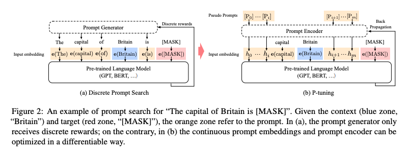
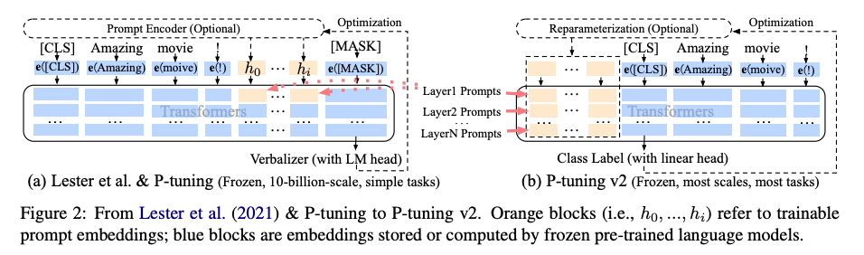

## P-tuning
```
It used a prompt encoder to encode the prompt to continuous hidden state and then finetune the model.
```


### Limitations
- performs bad on label sequence task
- hard to scale up
## P-tuning v2
```
It adds trainable prompt vectors to every layers and throw the verbalizer away since the verbalizer could become a bottleneck when the model's parameter size is small
```



<!-- related:start -->
## 相关笔记

- [微调索引](%E5%BE%AE%E8%B0%83%E7%B4%A2%E5%BC%95.md)
- [Prefix-Tuning 原理与实战](Prefix-Tuning%20%E5%8E%9F%E7%90%86%E4%B8%8E%E5%AE%9E%E6%88%98.md)
<!-- related:end -->
