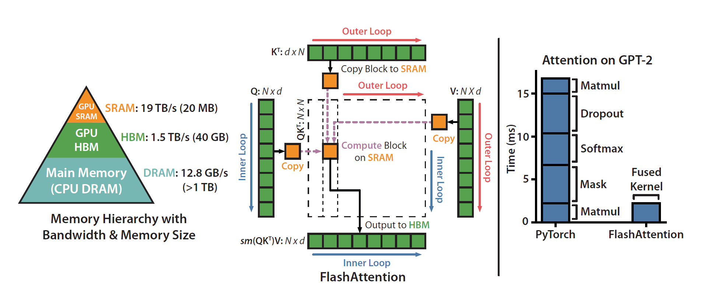

## Flash Attention
1. Reduce Memory Access by **reducing attention computation** via fusion （不把中间值写回HBM (e.g., the result of QK)）
2. Move memory to shared memory
3. Trade memory for computation/accuracy
4. Flash Attention

- 避免注意力矩阵从HBM中的读写，减少io访问量。
- 通过分块计算，融合多个操作如：online softmax（加或减去全局最大值）， safe softmax（防止softmax结果过大溢出），减少中间结果缓存。
- 反向传播时**重新计算中间结果**。

## Flash Attention V2

<!-- related:start -->
## 相关笔记

- [分布式训练与GPU索引](%E5%88%86%E5%B8%83%E5%BC%8F%E8%AE%AD%E7%BB%83%E4%B8%8EGPU%E7%B4%A2%E5%BC%95.md)
- [DeepSpeed](DeepSpeed.md)
- [常见分布式训练问题](%E5%B8%B8%E8%A7%81%E5%88%86%E5%B8%83%E5%BC%8F%E8%AE%AD%E7%BB%83%E9%97%AE%E9%A2%98.md)
<!-- related:end -->
